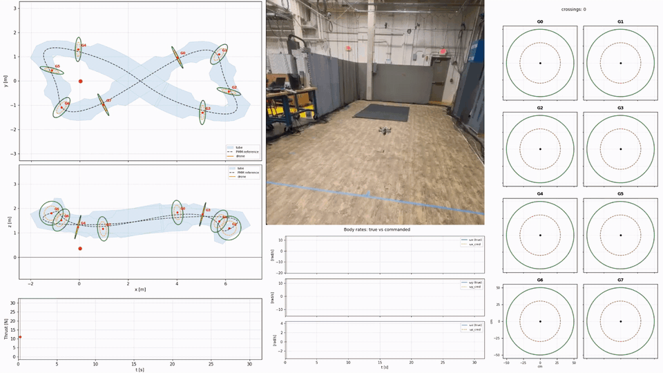
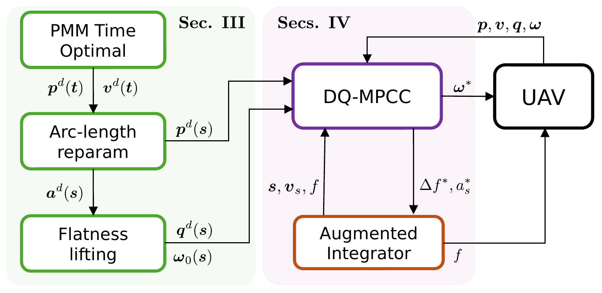
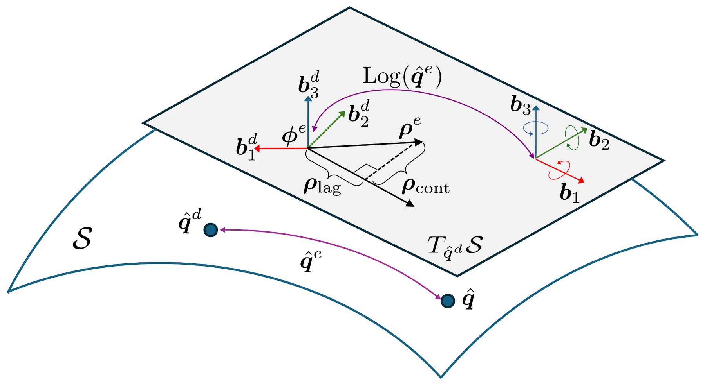
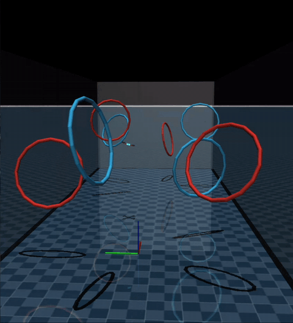
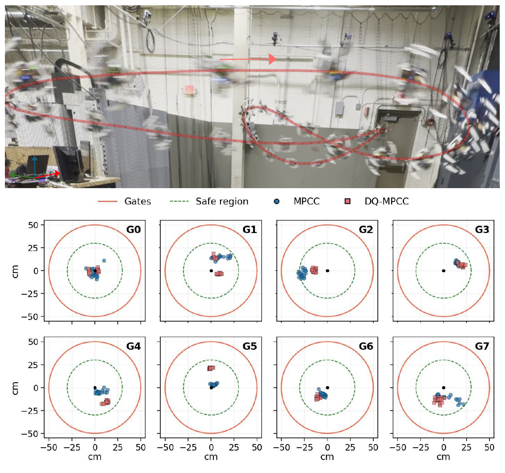
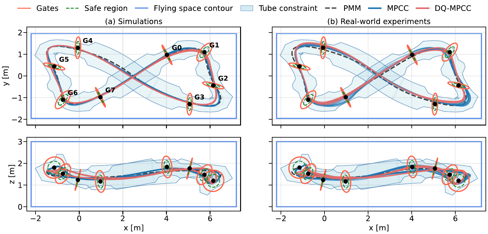

<div align="center">

# DQ-MPCC: Dual-Quaternion MPCC for Quadrotor Racing

**Bryan S. Guevara, Luis F. Recalde, Guanrui Li, Tiago Nascimento**

*IEEE Robotics and Automation Letters, 2026 (accepted)*




</div>

DQ-MPCC is a model predictive contouring controller for quadrotor racing that
predicts the vehicle with dual-quaternion pose and body-frame twist dynamics,
optimizes progress along the path online, and penalizes lag and contouring
errors defined in desired-body-frame pose-error coordinates. A conventional
MPCC baseline with the same solver, horizon, constraints and reference is
included for comparison.

This repository contains the implementation, the deployed configurations, and
the complete tuning data used in the article.

## Method

<table>
<tr>
<td width="50%" valign="top"></td>
<td width="50%" valign="top"></td>
</tr>
<tr>
<td valign="top"><sub>The reference path is planned once (point-mass minimum-time lap through the
gates), reparametrized by arc length and lifted to a full pose by differential
flatness. Online, DQ-MPCC optimizes the progress along that path together with
the body rates and the thrust rate, and sends the body-rate command to the
flight controller.</sub></td>
<td valign="top"><sub>The dual-quaternion pose error is mapped to desired-body-frame pose-error
coordinates. Its translational component is split along the path tangent into
the lag and contouring errors used by the controller cost.</sub></td>
</tr>
</table>

## Results

<table>
<tr>
<td width="38%"></td>
<td></td>
</tr>
<tr>
<td align="center"><sub>Software-in-the-loop (MuJoCo)</sub></td>
<td align="center"><sub>Real-world circuit and gate crossings</sub></td>
</tr>
</table>

Both controllers run onboard at **100 Hz** on an NVIDIA Jetson Orin NX.

| | MPCC | DQ-MPCC |
|--|--:|--:|
| Minimum lap time, SiL (n = 100) | 3.457 s | **3.226 s** (−6.7 %) |
| Minimum lap time, real world | 3.872 s | **3.464 s** (−10.5 %) |
| Real-world attempts completing three laps | 6 / 11 | **6 / 7** |
| Completed flights within the gate-crossing margin | 2 / 6 | **6 / 6** |

The real-world flights use the simulation gains without retuning. The full set
of metrics reported in the article is in [`results/paper_metrics.csv`](results/paper_metrics.csv).

<p align="center">

</p>

## Repository layout

| Path | Content |
|--|--|
| [`controller/`](controller) | ROS 2 package `quadrotor_mpc`: both controllers, OCP generators, reference pipeline, launch files |
| [`config/`](config) | Deployed configurations: MPCC trial 76 and DQ-MPCC trial 46 |
| [`tuning/`](tuning) | Complete final Pareto fronts, selected gains and the configuration-selection protocol |
| [`results/`](results) | Metrics reported in the article |
| [`scripts/`](scripts) | Data validation and Pareto-front plotting |

All controller weights are reported using the notation and pose-error
convention of the manuscript and the deployed controller.

### Controller names in the code

| Article | Code (executables, launch files, gain files) |
|--|--|
| MPCC baseline | `mpcc` |
| DQ-MPCC (deployed, `J_l^{-1} = I`) | `dq_mpcc_ablation` |
| DQ-MPCC with the exact `J_l^{-1}` (fixed-gain comparison) | `dq_mpcc` |

## Getting started

### Dependencies

- ROS 2 Humble, CMake, a C++17 compiler, Eigen, nlohmann_json
- [acados](https://github.com/acados/acados) with its Python interface and CasADi
  (tested with acados v0.5.4 and CasADi 3.7.2); set `ACADOS_SOURCE_DIR`
- Message packages `quadrotor_msgs` and `mav_manager_srv` from the flight stack
- Software-in-the-loop: a MuJoCo quadrotor simulator exposing the ROS 2
  interface in `controller/include/quadrotor_mpc/mujoco/` (not included)
- Real flights: the flight controller `dq_cpp` and the serial bridge to the
  flight-controller board (not included)

### Build

```bash
mkdir -p ~/dqmpcc_ws/src
cp -r controller ~/dqmpcc_ws/src/quadrotor_mpc
cd ~/dqmpcc_ws/src/quadrotor_mpc
export ACADOS_SOURCE_DIR=/path/to/acados

# The reference is embedded in the generated solvers; generate them on the target computer.
python3 ocp_generation/generate_mpcc_ocp.py
python3 ocp_generation/generate_dq_mpcc_ablation_ocp.py
python3 ocp_generation/generate_dq_mpcc_ocp.py

cd ~/dqmpcc_ws
colcon build --packages-select quadrotor_mpc     # Release (-O3) by default
source install/setup.bash
```

### Run in software-in-the-loop

With the simulator running:

```bash
ros2 launch quadrotor_mpc sil_mpcc.launch.py          # MPCC, trial 76
ros2 launch quadrotor_mpc sil_dq_ablation.launch.py   # DQ-MPCC, trial 46
ros2 launch quadrotor_mpc sil_dq_mpcc.launch.py       # exact J_l^-1 at the trial 46 gains
```

The launch files load the deployed configurations by default; pass
`pareto_path:=/abs/path.json` to use another gain file.

### Real flights

`controller/launch/experiment.launch.py` starts the racing controllers with the
flight stack. After takeoff, `ros2 run quadrotor_mpc mpcc_on` (or `dq_ablation_on`)
hands control to the racing controller; after three laps the vehicle decelerates
and control returns to the flight controller for landing. Pass
`quad_name:=<namespace>` and `platform_type:=<name>` (the platform configuration
of the flight stack) to match your vehicle.

### Reference

The eight-gate figure-eight reference is provided in `controller/path_planing/`.
To regenerate it, run in order `circuits/gate8/path_lissajous.py`,
`path_time_3D_PMM_periodic.py`, `build_multilap_reference.py`,
`build_flat_reference.py`, `export_ref_json.py` and `design_tube.py`, then
regenerate the solvers and rebuild.

## Tuning data

[`tuning/pareto_fronts.csv`](tuning/pareto_fronts.csv) lists every
non-dominated configuration of the final tuning stage (12 MPCC, 11 DQ-MPCC),
and [`tuning/selection_protocol.md`](tuning/selection_protocol.md) gives the
selection rule: five-run screening with solid gates, then crossing-margin
validation over n = 100 runs.

```bash
python3 scripts/validate_release.py          # consistency checks of the CSV and JSON files
python3 scripts/reproduce_pareto_figure.py   # writes tuning_fronts.pdf
```

## Onboard configuration

acados SQP-RTI, ERK4, PARTIAL_CONDENSING_HPIPM, Gauss-Newton Hessian, horizon
N = 31 (T_p = 1.48 s, non-uniform grid 10 × 20 ms + 10 × 40 ms + 11 × 80 ms),
100 Hz loop, CPU frequency locked at 1.574 GHz, BLASFEO target GENERIC,
`OMP_NUM_THREADS=4`.

## Citation

```bibtex
@article{guevara2026dqmpcc,
  author  = {Guevara, Bryan S. and Recalde, Luis F. and Li, Guanrui and Nascimento, Tiago},
  title   = {{DQ-MPCC}: Dual-Quaternion {MPCC} for Quadrotor Racing},
  journal = {IEEE Robotics and Automation Letters},
  year    = {2026}
}
```

## Acknowledgments

This work was supported by the National Council for Scientific and
Technological Development (CNPq) under research projects 401097/2025-0,
443960/2024-0 and 304551/2023-6, and by Petrobras under cooperation agreement
0050.0132311.25.9.

## License

BSD 3-Clause, see [LICENSE](LICENSE). Third-party dependencies keep their own licenses.
